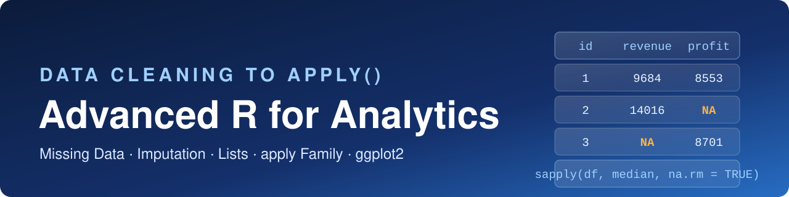
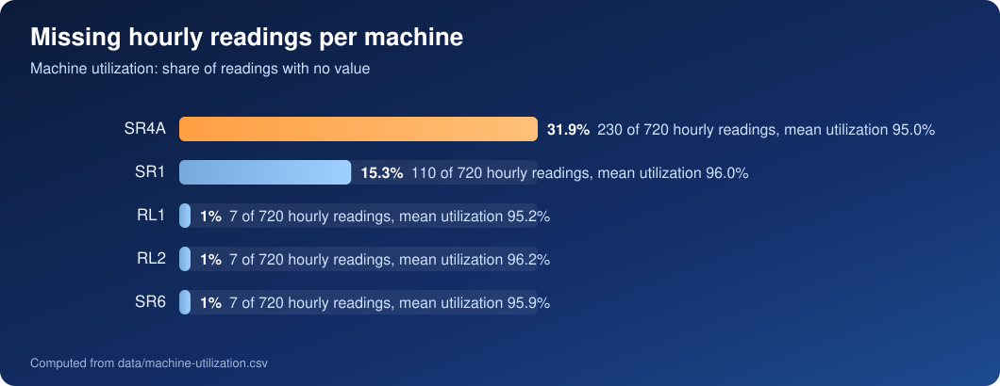

<p align="center">
  <a href="https://www.r-project.org/"></a>
  <a href="https://ggplot2.tidyverse.org/"></a>
  <a href="https://posit.co/products/open-source/rstudio/"></a>
  <a href=".github/workflows/r-check.yml"></a>
  
  
</p>

An advanced R course in **31 commented lecture scripts**: clean a messy real-world dataset, find and impute its missing values, work with lists, and put the `apply` family to use on weather data. Each script is one lecture: explanation, runnable examples and key takeaways in the comments.

> *"Real data is never clean: 31 scripts, 3,633 lines of annotated R, three datasets, and missing values everywhere."*

---

## Course map

| # | Section | Scripts | What you work on |
|:-:|---------|:-------:|------------------|
| 00 | [Quickstart](00-quickstart/) 🎯 | 1 | Missing values and imputation in one small script |
| 01 | [Data Cleaning](01-data-cleaning/) 🧹 | 16 | Text to numbers, factors, locating / removing / imputing `NA` |
| 02 | [Lists and Subsetting](02-lists-and-subsetting/) 🗂️ | 7 | Lists, `[]` vs `[[]]`, machine-utilization analysis |
| 03 | [Apply Functions](03-apply-functions/) 🧮 | 8 | `apply`, `lapply`, `sapply` on weather data |

---

## Learning path

```
 Quickstart ──► Data Cleaning ──────────► Lists & Subsetting ──► Apply Functions
   (00)          text → numbers            create / name           apply  lapply
                 factor trap               extract  [] [[]] $      sapply nesting
                 find / filter NA          add / delete            which.max / min
                 remove / impute NA        analysis + time series  custom functions
```

Section 1 prepares a dataset until it is analysis-ready, Section 2 gives you R's most flexible container, and Section 3 shows how to run a computation over many objects without writing loops.

---

## Featured: missing data, in real numbers

Missing values run through the whole course, so here is where they actually are in the two datasets (both charts are computed from the CSV files in [`data/`](data/)).


Future-500 has only a handful of empty cells (8 of its 11 columns), but its numeric columns arrive as text (`$9,684,527`, `1,130,700 Dollars`, `19%`), so cleaning them with `gsub()` comes before any imputation.



The machine-utilization data is different: two machines lose a large share of their hourly readings, which is why the course spends time on **how** to fill gaps (median, derived values, KNN) and not only **whether** to.

| Dataset | Size | Used in |
|---------|------|---------|
| [`data/future-500.csv`](data/future-500.csv) | 500 companies × 11 columns | Section 1 |
| [`data/machine-utilization.csv`](data/machine-utilization.csv) | 3,600 hourly readings, 5 machines | Section 2 |
| [`data/weather/`](data/weather/) | 4 cities, Fahrenheit and Celsius | Section 3 |

Details and a data dictionary: [`data/README.md`](data/README.md).

<details>
<summary>📈 Sample from <code>01-data-cleaning/12-median-imputation.R</code></summary>

```r
cat("\n🔹 Calculating the median for 'Employees':\n")
median_employees <- median(fin$Employees, na.rm = TRUE)  # Exclude missing values
cat("Median (all industries):", median_employees, "\n")

fin$Employees[is.na(fin$Employees)] <- median_employees  # Replace `NA` with the median
cat("✅ Missing 'Employees' values replaced with the overall median.\n")
```

</details>

---

## Script tour

<details>
<summary>🧹 <b>Section 1 — Data Cleaning</b> (16 scripts)</summary>

| Script | Topic |
|---|---|
| [`01-data-preparation-and-cleaning.R`](01-data-cleaning/01-data-preparation-and-cleaning.R) | Data preparation and cleaning: the whole workflow on Future-500 |
| [`02-the-factor-variable-trap.R`](01-data-cleaning/02-the-factor-variable-trap.R) | The factor variable trap: why converting a factor to numbers goes wrong |
| [`03-fvt-in-practice.R`](01-data-cleaning/03-fvt-in-practice.R) | The factor variable trap in practice |
| [`04-using-gsub-and-sub.R`](01-data-cleaning/04-using-gsub-and-sub.R) | Cleaning text columns with `gsub()` and `sub()` ($, commas, "Dollars", %) |
| [`05-what-is-an-na.R`](01-data-cleaning/05-what-is-an-na.R) | What is an `NA`? |
| [`06-locate-missing-data.R`](01-data-cleaning/06-locate-missing-data.R) | An elegant way to locate missing data |
| [`07-data-filters-which.R`](01-data-cleaning/07-data-filters-which.R) | Data filters: `which()` for non-missing data |
| [`08-data-filters-is-na.R`](01-data-cleaning/08-data-filters-is-na.R) | Data filters: `is.na()` for missing data |
| [`09-removing-records-with-missing-data.R`](01-data-cleaning/09-removing-records-with-missing-data.R) | Removing records with missing data |
| [`10-index-reset-and-na-handling.R`](01-data-cleaning/10-index-reset-and-na-handling.R) | Resetting the row index and handling `NA` |
| [`11-replacing-with-derived-values.R`](01-data-cleaning/11-replacing-with-derived-values.R) | Replacing missing data with derived values (profit = revenue − expenses) |
| [`12-median-imputation.R`](01-data-cleaning/12-median-imputation.R) | Replacing missing data with the median |
| [`13-median-imputation-part-2.R`](01-data-cleaning/13-median-imputation-part-2.R) | Median imputation, part 2 |
| [`14-median-imputation-part-3.R`](01-data-cleaning/14-median-imputation-part-3.R) | Median imputation, part 3 |
| [`15-dealing-with-missing-data.R`](01-data-cleaning/15-dealing-with-missing-data.R) | Dealing with missing data: overview plus KNN and multiple imputation |
| [`16-visualizing-results.R`](01-data-cleaning/16-visualizing-results.R) | Visualizing the results after handling missing data (ggplot2) |

</details>

<details>
<summary>🗂️ <b>Section 2 — Lists and Subsetting</b> (7 scripts)</summary>

| Script | Topic |
|---|---|
| [`01-understanding-lists.R`](02-lists-and-subsetting/01-understanding-lists.R) | Understanding lists (builds the objects the next lectures reuse) |
| [`02-naming-components.R`](02-lists-and-subsetting/02-naming-components.R) | Naming the components of a list |
| [`03-extracting-components.R`](02-lists-and-subsetting/03-extracting-components.R) | Extracting components: `[]` vs `[[]]` vs `$` |
| [`04-subsetting-lists.R`](02-lists-and-subsetting/04-subsetting-lists.R) | Subsetting lists |
| [`05-adding-and-deleting-components.R`](02-lists-and-subsetting/05-adding-and-deleting-components.R) | Adding and deleting components |
| [`06-data-analysis-and-insights.R`](02-lists-and-subsetting/06-data-analysis-and-insights.R) | Data analysis and insights on machine utilization |
| [`07-time-series-visualization.R`](02-lists-and-subsetting/07-time-series-visualization.R) | Time-series visualization with ggplot2 |

</details>

<details>
<summary>🧮 <b>Section 3 — Apply Functions</b> (8 scripts)</summary>

| Script | Topic |
|---|---|
| [`01-importing-data.R`](03-apply-functions/01-importing-data.R) | Importing the weather CSV files |
| [`02-weather-analysis-with-apply.R`](03-apply-functions/02-weather-analysis-with-apply.R) | Weather analysis with `apply()` and its family |
| [`03-advanced-weather-analysis.R`](03-apply-functions/03-advanced-weather-analysis.R) | Advanced weather analysis with loops and `apply()` |
| [`04-combining-lapply.R`](03-apply-functions/04-combining-lapply.R) | Combining `lapply()` with `[]` |
| [`05-adding-your-own-functions.R`](03-apply-functions/05-adding-your-own-functions.R) | Adding your own functions with `lapply()` |
| [`06-using-sapply.R`](03-apply-functions/06-using-sapply.R) | Using `sapply()` |
| [`07-nesting-apply.R`](03-apply-functions/07-nesting-apply.R) | Nesting `apply()` functions |
| [`08-which-max-and-which-min.R`](03-apply-functions/08-which-max-and-which-min.R) | Using `which.max()` and `which.min()` |

</details>

---

## Repository layout

```
Advanced-R-for-Analytics/
├── 00-quickstart/          # short warm-up script
├── 01-data-cleaning/       # one folder per course section,
├── 02-lists-and-subsetting/#   each with its own README
├── 03-apply-functions/
├── data/                   # datasets used by the scripts
├── assets/                 # README banner and charts
├── .github/                # CI
└── Advanced-R-for-Analytics.Rproj
```

**Why a single `main`?** This repo used to keep every section on its own branch. Everything now lives on `main`, and the original branch history is preserved in the commit graph.

---

## Quick start

```bash
git clone https://github.com/evgeniimatveev/Advanced-R-for-Analytics.git
cd Advanced-R-for-Analytics
```

1. Open **`Advanced-R-for-Analytics.Rproj`** in RStudio. It sets the working directory to the repo root, which the scripts rely on (e.g. `data/future-500.csv`).
2. Install the packages once: `install.packages(c("ggplot2", "mice"))` (`mice` is only used in the imputation overview).
3. Work through the sections in order, running each script top to bottom.

---

## Continuous integration

Every push and pull request runs [`r-check.yml`](.github/workflows/r-check.yml):

| Check | What it catches |
|-------|-----------------|
| **Parse every `.R` file** | Syntax errors |
| **Absolute path scan** | Hard-coded paths such as `C:/Users/...` |
| **File-name hygiene** | Spaces in file names |

Scripts are teaching material, so they are not executed on every push. A second workflow, [`r-run-scripts.yml`](.github/workflows/r-run-scripts.yml), is **manual**: Actions → *R script smoke run (manual)* → *Run workflow*. It runs every script in its own R process and writes a pass/fail table to the Job Summary. Last full run: **30 of 31 scripts pass, 1 skipped** (it needs the retired `DMwR` package).

---

## Known limitations

- `01-data-cleaning/15-dealing-with-missing-data.R` uses the `DMwR` package, which was removed from CRAN; its KNN example cannot run on a current R. The `mice` example in the same script is still valid.
- The course builds on earlier lectures, so a few scripts expect objects from a previous one: `02-naming-components` and `04-subsetting-lists` need `01-understanding-lists.R`, `05-adding-and-deleting-components` needs `01` and `04`, and `16-visualizing-results` needs `01-data-preparation-and-cleaning.R`. The READMEs flag them with ↩️.
- Several scripts write a cleaned CSV into the working directory. These files are git-ignored.
- The script order inside each section follows the logical flow of the lectures; the original repo had no numbering.

---

## Credits

The Future-500, machine-utilization and weather datasets and parts of the exercises come from Super Data Science course material. The scripts are my annotated working copies.

---

## Tech stack

`R` · `RStudio` · `ggplot2` · `base R (apply family)` · `GitHub Actions`

---

*Built by [Evgenii Matveev](https://github.com/evgeniimatveev) · Data Analyst / Analytics & MLOps Engineer*
